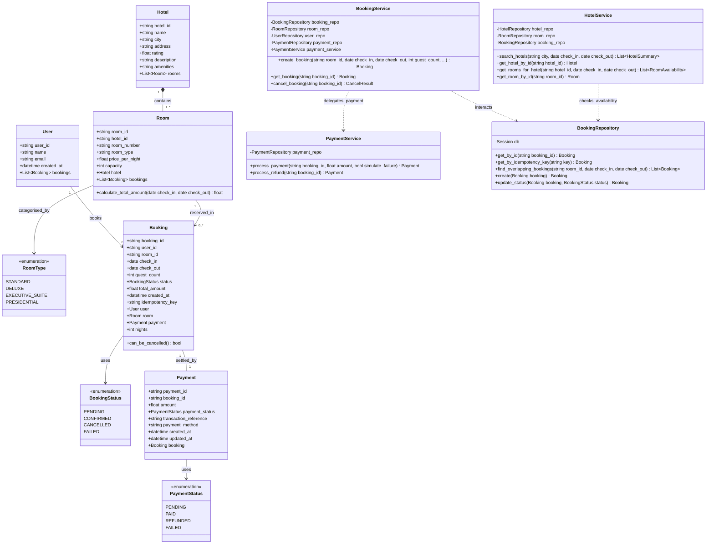

# Low-Level Design (LLD): UML Class Diagram

This document illustrates the Object-Oriented Design (OOD) and class architecture implemented in the Online Hotel Booking Platform.

## 1. Class Diagram (Mermaid)

## 2. Multiplicities and Relationships Explanation

1. **Hotel to Room (`1` to `1..*`)**: Composition. A hotel owns multiple rooms. If a hotel record is removed, its associated rooms are cascaded.
2. **User to Booking (`1` to `0..*`)**: One-to-Many association. A registered customer can make multiple bookings over time.
3. **Room to Booking (`1` to `0..*`)**: One-to-Many association. A single room unit can have many historical and future reservations, subject to interval disjointness.
4. **Booking to Payment (`1` to `1`)**: One-to-One relationship. Each booking has exactly one payment ledger record tracking authorization, charge, or refund states.
5. **Enums**:
   - `BookingStatus`: States include `CONFIRMED`, `CANCELLED`, `PENDING`, and `FAILED`.
   - `PaymentStatus`: States include `PAID`, `REFUNDED`, `PENDING`, and `FAILED`.
