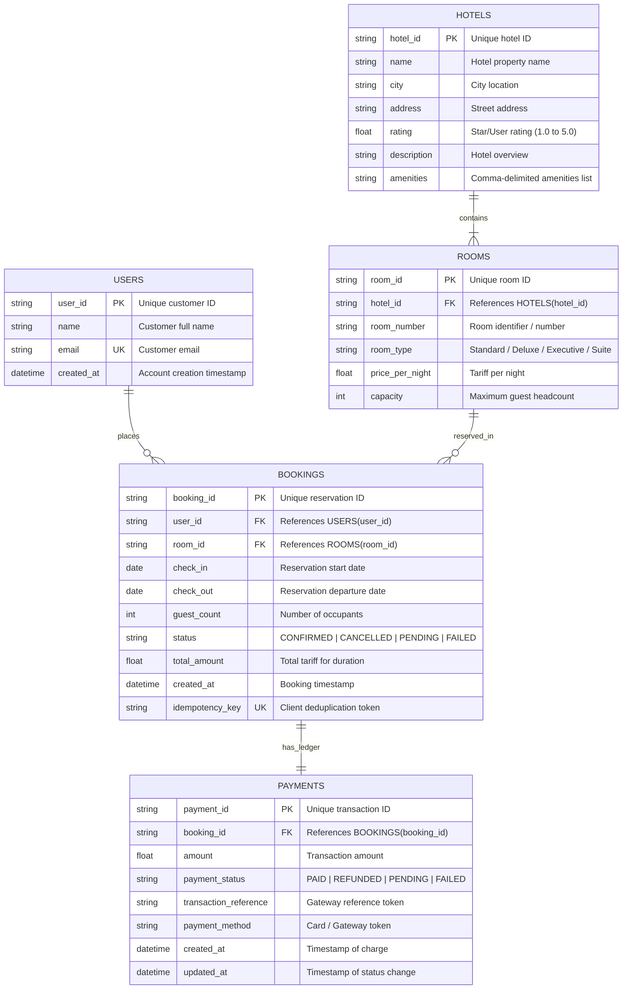

# Low-Level Design (LLD): Database Schema & ER Diagram

## 1. Entity-Relationship (ER) Diagram

## 2. Table Definitions & Constraints

### Table: `users`
- `user_id` VARCHAR(64) PRIMARY KEY
- `name` VARCHAR(128) NOT NULL
- `email` VARCHAR(128) NOT NULL UNIQUE
- `created_at` DATETIME NOT NULL

### Table: `hotels`
- `hotel_id` VARCHAR(64) PRIMARY KEY
- `name` VARCHAR(255) NOT NULL (Index)
- `city` VARCHAR(100) NOT NULL (Index)
- `address` VARCHAR(255) NOT NULL
- `rating` FLOAT NOT NULL
- `description` VARCHAR(500)
- `amenities` VARCHAR(255)

### Table: `rooms`
- `room_id` VARCHAR(64) PRIMARY KEY
- `hotel_id` VARCHAR(64) NOT NULL FOREIGN KEY REFERENCES `hotels(hotel_id)` ON DELETE CASCADE
- `room_number` VARCHAR(20) NOT NULL
- `room_type` VARCHAR(50) NOT NULL
- `price_per_night` FLOAT NOT NULL
- `capacity` INTEGER NOT NULL

### Table: `bookings`
- `booking_id` VARCHAR(64) PRIMARY KEY
- `user_id` VARCHAR(64) NOT NULL FOREIGN KEY REFERENCES `users(user_id)`
- `room_id` VARCHAR(64) NOT NULL FOREIGN KEY REFERENCES `rooms(room_id)`
- `check_in` DATE NOT NULL (Index)
- `check_out` DATE NOT NULL (Index)
- `guest_count` INTEGER NOT NULL
- `status` VARCHAR(20) NOT NULL (Index)
- `total_amount` FLOAT NOT NULL
- `created_at` DATETIME NOT NULL
- `idempotency_key` VARCHAR(128) UNIQUE (Index)
- **Composite Index**: `idx_room_dates_status (room_id, check_in, check_out, status)` ensures $O(\log N)$ date overlap searches.

### Table: `payments`
- `payment_id` VARCHAR(64) PRIMARY KEY
- `booking_id` VARCHAR(64) NOT NULL UNIQUE FOREIGN KEY REFERENCES `bookings(booking_id)` ON DELETE CASCADE
- `amount` FLOAT NOT NULL
- `payment_status` VARCHAR(20) NOT NULL (Index)
- `transaction_reference` VARCHAR(128) NOT NULL
- `payment_method` VARCHAR(50) NOT NULL
- `created_at` DATETIME NOT NULL
- `updated_at` DATETIME NOT NULL
