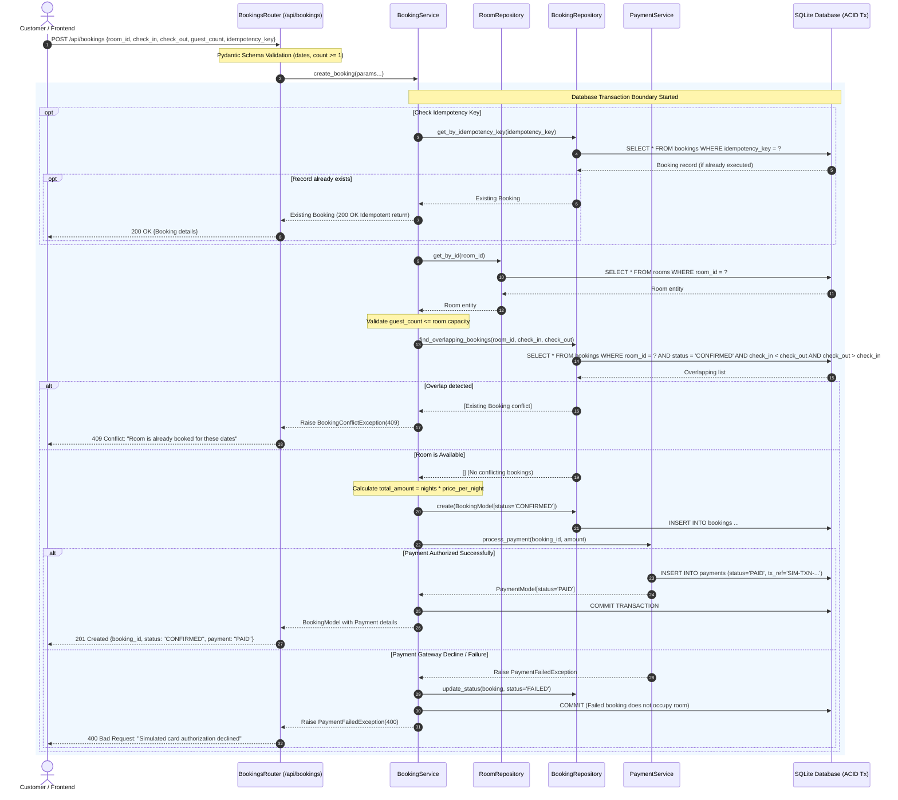

# Low-Level Design (LLD): Booking Creation Sequence Diagram

This diagram documents the complete step-by-step interaction between the client, API router, domain services, repository data layer, database transaction boundaries, and simulated payment gateway.

## Highlights of Concurrency and Integrity

1. **Atomic Interval Check**: Overlapping bookings are evaluated against active `CONFIRMED` reservations.
2. **Idempotency Guarantee**: If network issues cause the client to retry the request with the same `idempotency_key`, the backend immediately detects the prior reservation and returns it without double charging or duplicate record creation.
3. **Isolation on Failure**: If a simulated payment fails, the reservation state is marked `FAILED`, guaranteeing that future booking queries for those dates are not blocked.
